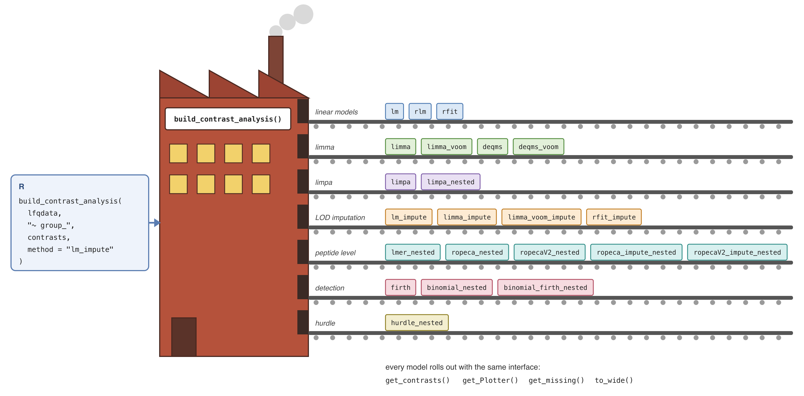
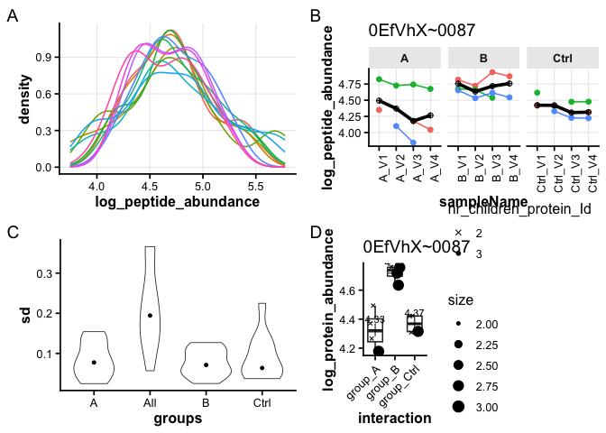
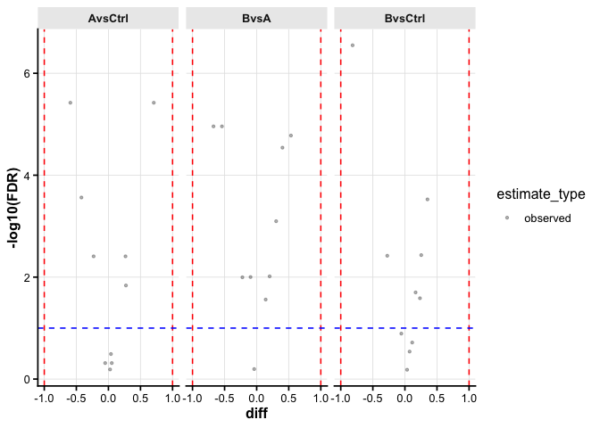

<!-- README.md is generated from README.Rmd. Please edit that file and run devtools::build_readme(). -->

[](https://www.repostatus.org/#active)
[](https://github.com/fgcz/prolfqua/actions/workflows/r.yaml)
[](https://app.codecov.io/gh/fgcz/prolfqua)

[](https://pubs.acs.org/doi/10.1021/acs.jproteome.2c00441)
[](https://doi.org/10.5281/zenodo.18775726)


# prolfqua - a comprehensive R package for Proteomics Differential Expression Analysis

The R package contains functions for analysing mass spectrometry based
experiments. It is intended for proteomics core facilities and
researchers who analyse label-free protein or peptide intensities
quantified with MaxQuant, DIA-NN, Spectronaut, FragPipe or similar
software. This package is developed at the [FGCZ](https://fgcz.ch/). The
package documentation including vignettes can be accessed at
<https://fgcz.github.io/prolfqua/index.html>

`prolfqua` makes easy things easy while remaining fully hackable.

At its centre is a factory, `build_contrast_analysis()`: one call fits a
model per protein and computes the requested contrasts. The `method`
argument selects one of 20 models, and every model returns its results
through the same interface. Start with the [Introduction to
prolfqua](https://fgcz.github.io/prolfqua/articles/prolfqua.html).



# Statement of need

Label-free quantification (LFQ) experiments measure thousands of
proteins or peptides in few samples, and values go missing more often at
low intensity. Methods for their differential expression analysis are
spread over packages with different input formats, model specifications
and outputs (limma, DEqMS, MSstats, msqrob2, proDA, limpa), which makes
it hard to choose a method for a dataset or to compare methods on it.

prolfqua gives these methods one data model, a long table with an
`AnalysisConfiguration` naming the column roles; one model
specification, R’s formula interface including mixed models; and one
output format. `build_contrast_analysis()` fits any of its 20 methods
and returns contrasts with the same columns, so a core facility can run,
compare and report them in one workflow, and a researcher can check how
much a result depends on the method. prolfqua also covers the steps
around the test: quality control, normalisation, aggregation of peptides
to proteins and sample-size estimation.

# How to install prolfqua?

prolfqua requires R (\>= 4.6); check your version with
`R.version.string` and update R first if needed.

prolfqua is part of
[Bioconductor](https://bioconductor.org/packages/prolfqua/) from release
3.24. To install the Bioconductor release:

``` r
if (!requireNamespace("BiocManager", quietly = TRUE)) {
  install.packages("BiocManager")
}
BiocManager::install("prolfqua")
```

If BiocManager reports that prolfqua is not available for your
Bioconductor version, update Bioconductor with
`BiocManager::install(version = "3.24")` and run
`BiocManager::install("prolfqua")` again.

Bioconductor publishes a release every six months. The development
version on GitHub has the changes made since then, listed in the
[changelog](https://fgcz.github.io/prolfqua/news/index.html). Installing
it from GitHub needs the remotes package:

``` r
install.packages(c("BiocManager", "remotes"))
BiocManager::install("fgcz/prolfqua")
```

`packageVersion("prolfqua")` shows which version you have installed.

Some methods and plots use packages listed under `Suggests`; prolfqua
asks to install them when they are needed.

Let us please know about any installation problems or errors when using
the package: <https://github.com/fgcz/prolfqua/issues>

# How to get started

How to build a `LFQData` object from a table with protein or peptide
quantification results, and a table with sample annotation is described
in more detail in the [Importing your data
vignette](https://fgcz.github.io/prolfqua/articles/CreatingConfigurations.html).

A minimal example for a table with protein abundances is:

``` r
# Table with abundances
df <- data.frame(
  protein_Id = c("tr|A|HUMAN", "tr|B|HUMAN", "tr|C|HUMAN", "tr|D|HUMAN"),
  Intensity_A = c(100, 10000, 10, NA),
  Intensity_B = c(NA, 9000, 20, 100),
  Intensity_C = c(200, 8000, NA, 150),
  Intensity_D = c(130, 11000, 50, 50)
)
# Table with sample annotation
annot <- data.frame(
  Sample = c("Intensity_A", "Intensity_B", "Intensity_C", "Intensity_D"),
  Group = c("A", "A", "B", "C")
)

# convert into long format
table_long <- tidyr::pivot_longer(df, dplyr::starts_with("Intensity_"), names_to = "Sample", values_to = "Intensity")
table_long <- dplyr::inner_join(annot, table_long, by = "Sample")
# peptides per protein and sample; used as weights by some methods (1 if unknown)
table_long$nr_children <- 1L

# create the AnalysisConfiguration
config <- prolfqua::AnalysisConfiguration$new()
config$file_name <- "Sample"
config$work_intensity <- "Intensity"
config$hierarchy[["protein_Id"]] <- "protein_Id"
config$factors[["Group"]] <- "Group"

# Build LFQData object
analysis_data <- prolfqua::setup_analysis(table_long, config)
#> creating sampleName from file_name column
#> no qValue column specified in the data. Creating column qValue and setting qValues to 0.
lfqdata <- prolfqua::LFQData$new(analysis_data, config)
lfqdata$hierarchy_counts()
#> # A tibble: 1 × 1
#>   protein_Id
#>        <int>
#> 1          4
```

Once you have created an `LFQData` you can use prolfqua like this.

``` r
library(prolfqua)

## here we simulate peptide level data
startdata <- sim_lfq_data_peptide_config()
lfqpep <- LFQData$new(startdata$data, startdata$config)

## transform intensities and aggregate peptides to proteins
lfqpep <- lfqpep$get_Transformer()$log2()$robscale()$lfq
lfqpep$rename_response("log_peptide_abundance")
agr <- lfqpep$get_Aggregator()
lfqpro <- agr$aggregate()
lfqpro$rename_response("log_protein_abundance")

## plot Figure 3 panels A-D
pl <- lfqpep$get_Plotter()
panelA <- pl$intensity_distribution_density() +
  ggplot2::labs(tag = "A") + ggplot2::theme(legend.position = "none")
panelB <- agr$plot()$plots[[1]] + ggplot2::labs(tag = "B")
panelC <- lfqpro$get_Stats()$violin() + ggplot2::labs(tag = "C")
pl <- lfqpro$get_Plotter()
panelD <- pl$boxplots()$boxplot[[1]] + ggplot2::labs(tag = "D")
gridExtra::grid.arrange(panelA, panelB, panelC, panelD)
```



``` r
## specify contrasts
Contr <- c(
  "AvsCtrl" = "group_A - group_Ctrl",
  "BvsCtrl" = "group_B - group_Ctrl",
  "BvsA" = "group_B - group_A"
)

## fit a model per protein and compute the contrasts, here with limma
fa <- build_contrast_analysis(lfqpro, "~ group_", Contr, method = "limma")
#> fit (limma): 4 missing responses dropped (e.g. 7cbcrd~5725, 9VUkAq~4703, CGzoYe~2147): NA response (missing observation) left out of the fit
#> See $provenance().
head(fa$get_contrasts())
#> # A tibble: 6 × 16
#>   modelName estimate_type protein_Id  contrast    diff        FDR
#>   <chr>     <chr>         <chr>       <chr>      <dbl>      <dbl>
#> 1 limma     observed      0EfVhX~0087 AvsCtrl  -0.0506 0.485     
#> 2 limma     observed      7cbcrd~5725 AvsCtrl   0.707  0.00000378
#> 3 limma     observed      9VUkAq~4703 AvsCtrl  -0.593  0.00000378
#> 4 limma     observed      BEJI92~5282 AvsCtrl   0.273  0.0146    
#> 5 limma     observed      CGzoYe~2147 AvsCtrl  -0.231  0.00391   
#> 6 limma     observed      DoWup2~5896 AvsCtrl   0.266  0.00391   
#> # ℹ 10 more variables: std.error.unmoderated <dbl>, df.unmoderated <dbl>,
#> #   std.error <dbl>, statistic <dbl>, p.value <dbl>, sigma <dbl>, df <dbl>,
#> #   conf.low <dbl>, conf.high <dbl>, avgAbd <dbl>

## volcano plot
fa$get_Plotter()$volcano()$FDR
```



# Detailed documentation with R code

Documents explaining how to run an analysis with prolfqua are at
<https://fgcz.github.io/prolfqua/index.html>.

1.  [Introduction to
    prolfqua](https://fgcz.github.io/prolfqua/articles/prolfqua.html)
2.  [Importing your
    data](https://fgcz.github.io/prolfqua/articles/CreatingConfigurations.html)
3.  [Comparing two
    groups](https://fgcz.github.io/prolfqua/articles/Comparing2Groups.html)
4.  [All modelling methods at a
    glance](https://fgcz.github.io/prolfqua/articles/ModellingMethods.html)
5.  [Two-factor
    designs](https://fgcz.github.io/prolfqua/articles/TwoFactorDesigns.html)
6.  [Contrasts from
    factors](https://fgcz.github.io/prolfqua/articles/ContrastsFromFactors.html)
7.  [Filling the gaps: model-based imputation for heatmaps and
    PCA](https://fgcz.github.io/prolfqua/articles/ModelBasedImputation.html)
8.  [QC and sample size
    estimation](https://fgcz.github.io/prolfqua/articles/QualityControlAndSampleSizeEstimation.html)
9.  [Transforming and calibrating LFQ
    data](https://fgcz.github.io/prolfqua/articles/TransformingLFQData.html)

[](https://www.youtube.com/watch?v=acDiXq2xbOw)

- Watch the [in silico
  talk](https://www.sib.swiss/in-silico-talks/prolfqua-a-comprehensive-r-package-for-protein-differential-expression-analysis)
- See our article at the [Journal of Proteome
  Research](https://doi.org/10.1021/acs.jproteome.2c00441)
- See [Bioconductor 2021 Conference
  poster](https://fgcz-proteomics.uzh.ch/~wolski/PosterBioconductor.html).
- Watch the lightning (8 min) talk at
  [EuroBioc2020](https://www.youtube.com/watch?v=jOXU4X7nV9I&t) on
  YouTube or [slides](https://f1000research.com/slides/9-1476).

# Design

The package for **pro**teomics **l**abel **f**ree **qua**ntification
`prolfqua` (read: prolevka) evolved from scripts written at the FGCZ to
visualise and analyse mass spectrometry data; some of them are still in
the R packages quantable, protViz and imsbInfer.

prolfqua stores the data in one table in long format, with an
`AnalysisConfiguration` naming the column roles: the hierarchy (for
example protein and peptide), the explanatory factors, the sample and
the response. Data in long format, as written by Spectronaut, Skyline or
DIA-NN, needs only this configuration; wide matrices, as written by
MaxQuant, are converted with `lfqdata_from_wide()`, and the
[prolfquapp](https://github.com/prolfqua/prolfquapp) package reads the
output of common quantification software. Results are data frames, so
dplyr and ggplot2 work on every step.

Models are specified with R’s formula interface, including lme4 formulas
for mixed models, so parallel, factorial and repeated-measurement
designs need no special code. On top of the model fits, prolfqua
implements p-value moderation as in limma, the peptide-median
aggregation of PECA and ROPECA, and refits at the limit of detection for
groups without observations, which makes these methods comparable within
one framework. Besides differential expression, prolfqua computes
coefficients of variation, estimates sample sizes, summarises missing
values and intensity distributions, aggregates peptides to proteins (top
N, Tukey’s median polish, robust regression) and compares models with
likelihood ratio tests.

To use `prolfqua`, knowledge of R’s regression model infrastructure is
an advantage.

## Related projects

- prolfquabenchmark - a package to document the performance of prolfqua,
  MSstats, msqrob2, and proDA. See documentation:
  <https://prolfqua.github.io/prolfquabenchmark/>
- prolfquapp: Generating Dynamic DEA Reports with the prolfqua R Package
  <https://github.com/prolfqua/prolfquapp>
- prophosqua - (scripts for the analysis of phospho experiments)
  <https://github.com/prolfqua/prophosqua>

## Related packages

- [limma](https://bioconductor.org/packages/limma/) and
  [DEqMS](https://bioconductor.org/packages/DEqMS/): moderated t-tests
  on a protein matrix; prolfqua’s `limma`, `limma_voom` and `deqms`
  methods call them
- [limpa](https://bioconductor.org/packages/limpa/): detection
  probability curve and precision weights; prolfqua’s `limpa` methods
  call it
- [PECA](https://bioconductor.org/packages/PECA/): peptide-median
  aggregation (PECA, ROPECA); prolfqua’s `ropeca_nested` is derived from
  it
- [MSstats](https://bioconductor.org/packages/MSstats/): protein
  summarisation and linear mixed models
- [msqrob2](https://bioconductor.org/packages/msqrob2/): robust ridge
  regression on peptide or protein level, built on QFeatures
- [proDA](https://bioconductor.org/packages/proDA/): probabilistic
  dropout model, inference without imputation
- [DAPAR](https://bioconductor.org/packages/DAPAR/) and
  [DAPARdata](https://bioconductor.org/packages/DAPARdata/): imputation
  and statistical analysis behind the Prostar interface
- [Triqler](https://github.com/statisticalbiotechnology/triqler):
  Bayesian error propagation from identification to quantification
  (Python)

## R packages to compute contrasts from linear and other models

- [marginaleffects](https://marginaleffects.com/) Compute and plot
  predictions, slopes, marginal means, and comparisons (contrasts, risk
  ratios, odds ratios, etc.) for over 70 classes of statistical models
  in R.
- [emmeans](https://CRAN.R-project.org/package=emmeans) Obtain estimated
  marginal means (EMMs) for many linear, generalized linear, and mixed
  models.
- [lmerTest](https://CRAN.R-project.org/package=lmerTest) computes
  contrast for [lme4](https://CRAN.R-project.org/package=lme4) models
- [multcomp](https://CRAN.R-project.org/package=multcomp) computes
  contrast for linear models and adjusts p-values (multiple comparison)

## Relevant background information

- [R Companion](https://rcompanion.org/rcompanion/h_01.html)
- [Extending the Linear Model with
  R](https://www.maths.bath.ac.uk/~jjf23/ELM/)
- [Contrasts in R - an example vignette by Rose
  Maier](https://rstudio-pubs-static.s3.amazonaws.com/65059_586f394d8eb84f84b1baaf56ffb6b47f.html)
- [Interactions and Contrasts PH525x
  series](https://genomicsclass.github.io/book/pages/interactions_and_contrasts.html)

# How to cite?

Please cite the [prolfqua article in the Journal of Proteome
Research](https://doi.org/10.1021/acs.jproteome.2c00441).
`citation("prolfqua")` gives the reference as text and as BibTeX.

# Code of Conduct

Please note that this package is released with a [Contributor Code of
Conduct](https://ropensci.org/code-of-conduct/). By contributing to this
project, you agree to abide by its terms.
