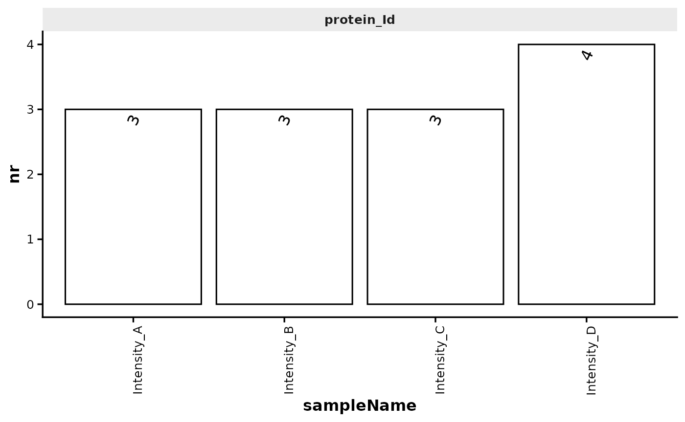

# Importing your data: AnalysisConfiguration

prolfqua works on one table in long format, one row per feature
(protein, peptide or precursor) and sample, together with an
`AnalysisConfiguration` that says which column holds what. This vignette
builds both from a table you already have.

## Output of quantification software

For the output of common quantification software, the
[prolfquapp](https://github.com/prolfqua/prolfquapp) package has readers
that return a ready `LFQData` object together with the protein
annotation:

- DIA-NN: `prolfquapp::preprocess_DIANN()`
- MaxQuant: `prolfquapp::preprocess_MQ_peptide()`
- Spectronaut: `prolfquapp::preprocess_BGS()`
- FragPipe: `prolfquapp::preprocess_FP_PSM()`
- MSstats-formatted tables: `prolfquapp::preprocess_MSstats()`

They need the FASTA file used for the search. prolfquapp is installed
from GitHub; see its README. The rest of this vignette shows how to
build an `LFQData` object from any other table.

## A table in wide format

Frequently, the data are available in tables where the rows are proteins
and the columns are samples. In the example, the first column holds the
protein identifier and the other columns the intensities of samples A to
D.

``` r
df <- data.frame(
  protein_Id = c("tr|A|HUMAN", "tr|B|HUMAN", "tr|C|HUMAN", "tr|D|HUMAN"),
  Intensity_A = c(100, 10000, 10, NA),
  Intensity_B = c(NA, 9000, 20, 100),
  Intensity_C = c(200, 8000, NA, 150),
  Intensity_D = c(130, 11000, 50, 50)
)
df
```

    ##   protein_Id Intensity_A Intensity_B Intensity_C Intensity_D
    ## 1 tr|A|HUMAN         100          NA         200         130
    ## 2 tr|B|HUMAN       10000        9000        8000       11000
    ## 3 tr|C|HUMAN          10          20          NA          50
    ## 4 tr|D|HUMAN          NA         100         150          50

This table can be converted into a table in long format:

``` r
table_long <- tidyr::pivot_longer(df, dplyr::starts_with("Intensity_"), names_to = "Sample", values_to = "Intensity")
table_long
```

    ## # A tibble: 16 × 3
    ##    protein_Id Sample      Intensity
    ##    <chr>      <chr>           <dbl>
    ##  1 tr|A|HUMAN Intensity_A       100
    ##  2 tr|A|HUMAN Intensity_B        NA
    ##  3 tr|A|HUMAN Intensity_C       200
    ##  4 tr|A|HUMAN Intensity_D       130
    ##  5 tr|B|HUMAN Intensity_A     10000
    ##  6 tr|B|HUMAN Intensity_B      9000
    ##  7 tr|B|HUMAN Intensity_C      8000
    ##  8 tr|B|HUMAN Intensity_D     11000
    ##  9 tr|C|HUMAN Intensity_A        10
    ## 10 tr|C|HUMAN Intensity_B        20
    ## 11 tr|C|HUMAN Intensity_C        NA
    ## 12 tr|C|HUMAN Intensity_D        50
    ## 13 tr|D|HUMAN Intensity_A        NA
    ## 14 tr|D|HUMAN Intensity_B       100
    ## 15 tr|D|HUMAN Intensity_C       150
    ## 16 tr|D|HUMAN Intensity_D        50

In addition you need a table with the sample annotation. In this example
there are three groups, A, B and C.

``` r
annot <- data.frame(
  Sample = c("Intensity_A", "Intensity_B", "Intensity_C", "Intensity_D"),
  Group = c("A", "A", "B", "C")
)
```

Join the annotation to the intensities. Protein-level data should also
say from how many peptides each protein intensity was computed in each
sample; some methods use this count as a weight. It is unknown here, so
it is set to 1.

``` r
table_long <- dplyr::inner_join(annot, table_long, by = "Sample")
table_long$nr_children <- 1L
```

Create an `AnalysisConfiguration` and name the columns: which one
identifies the sample and which one holds the intensities.

``` r
config <- prolfqua::AnalysisConfiguration$new()
config$file_name <- "Sample"
config$work_intensity <- "Intensity"
```

The columns identifying the measured features, which are proteins,
peptides or precursors, are described using the named list `hierarchy`.
The values of the list are the column names, while the names are
arbitrary as long as they are valid R column names. Here we use the same
names as the column names.

The list `factors` points to the columns with the explanatory variables
of the analysis (Group).

``` r
config$hierarchy[["protein_Id"]] <- "protein_Id"
config$factors[["Group"]] <- "Group"
```

[`setup_analysis()`](https://fgcz.github.io/prolfqua/reference/setup_analysis.md)
checks the table against the configuration and completes it, and
`LFQData$new()` creates the data object.

``` r
analysis_data <- prolfqua::setup_analysis(table_long, config)
lfqdata <- prolfqua::LFQData$new(analysis_data, config)
```

``` r
lfqdata$hierarchy_counts()
```

    ## # A tibble: 1 × 1
    ##   protein_Id
    ##        <int>
    ## 1          4

``` r
smrz <- lfqdata$get_Summariser()
smrz$plot_hierarchy_counts_sample()
```



## A matrix with row and sample annotation

When the intensities are already a matrix, with features in rows and
samples in columns, plus a table describing the rows and one describing
the samples,
[`lfqdata_from_wide()`](https://fgcz.github.io/prolfqua/reference/lfqdata_from_wide.md)
builds the `LFQData` object directly. It is the inverse of
`LFQData$data_wide(as.matrix = TRUE)`; row `i` of the matrix belongs to
row `i` of the row table.

``` r
intensities <- as.matrix(df[, -1])
rowdata <- data.frame(protein_Id = df$protein_Id)
samples <- data.frame(
  sampleName = annot$Sample,
  Sample = annot$Sample,
  Group = annot$Group
)
children <- matrix(1L, nrow = nrow(intensities), ncol = ncol(intensities), dimnames = dimnames(intensities))
from_wide <- prolfqua::lfqdata_from_wide(
  list(Intensity = intensities, nr_children = children),
  rowdata,
  samples,
  config
)
from_wide$hierarchy_counts()
```

    ## # A tibble: 1 × 1
    ##   protein_Id
    ##        <int>
    ## 1          4

## A table in long format

Long tables, such as the reports of Spectronaut, Skyline or DIA-NN, need
only a configuration. Here a simulated peptide table stands in for such
a report:

``` r
dataLongFormat <- prolfqua::sim_lfq_data(n_proteins = 20, peptide = TRUE)
head(dataLongFormat)
```

    ## # A tibble: 6 × 12
    ##   proteinID idtype2 average_prot_abundance    sd peptideID sample  group  mean
    ##   <chr>     <chr>                    <dbl> <dbl> <chr>     <chr>   <chr> <dbl>
    ## 1 5pb90S    1460                      20.5     1 mpxNAbn2  Ctrl_V1 Ctrl      0
    ## 2 5pb90S    1460                      20.5     1 mpxNAbn2  Ctrl_V2 Ctrl      0
    ## 3 5pb90S    1460                      20.5     1 mpxNAbn2  Ctrl_V3 Ctrl      0
    ## 4 5pb90S    1460                      20.5     1 mpxNAbn2  Ctrl_V4 Ctrl      0
    ## 5 5pb90S    1460                      22.5     1 mpxNAbn2  A_V1    A        -2
    ## 6 5pb90S    1460                      22.5     1 mpxNAbn2  A_V2    A        -2
    ## # ℹ 4 more variables: N <dbl>, avg_peptide_abd <dbl>, Replicate <chr>,
    ## #   abundance <dbl>

The sample is in the column `sample` and the intensity in `abundance`.
Each row is one peptide, so it counts as one child of its protein:

``` r
dataLongFormat$nr_children <- 1L
config <- prolfqua::AnalysisConfiguration$new()
config$file_name <- "sample"
config$work_intensity <- "abundance"
```

The hierarchy has two levels here, protein and peptide. The names of
`factors` are the names used in model formulas, figures and legends;
they can differ from the column names, for example
`config$factors[["Condition"]] <- "R.Condition"` for a Spectronaut
report. A table can hold several factors.

``` r
config$hierarchy[["proteinID"]] <- "proteinID"
config$hierarchy[["peptideID"]] <- "peptideID"
config$factors[["group"]] <- "group"
```

[`setup_analysis()`](https://fgcz.github.io/prolfqua/reference/setup_analysis.md)
creates from the long table a table that matches the configuration, and
`LFQData$new()` the data object, which is the start of every further
analysis.

``` r
analysis_data <- prolfqua::setup_analysis(dataLongFormat, config)
lfqdata <- prolfqua::LFQData$new(analysis_data, config)
lfqdata$summarize_hierarchy()
```

    ## # A tibble: 20 × 2
    ##    proteinID peptideID_n
    ##    <chr>           <int>
    ##  1 1DIdTQ              6
    ##  2 1SO1NY              2
    ##  3 2JOCP3              6
    ##  4 5pb90S              2
    ##  5 OyHgjC              2
    ##  6 PDPfVe              2
    ##  7 TvODf3              2
    ##  8 UHjlsA              2
    ##  9 UmCi4L              1
    ## 10 Vphs0t              6
    ## 11 Xp1Tno              1
    ## 12 de5llz              2
    ## 13 hwBDgU              2
    ## 14 pGZKaB              1
    ## 15 rNWbGH              1
    ## 16 wXXHRN              6
    ## 17 yOSJAW              6
    ## 18 yj3Whg             10
    ## 19 z9WqiE              2
    ## 20 zVMmad              2

With this, it is possible for example to use the `get_Summariser`
function to visualize and summarise the data.

``` r
smrz <- lfqdata$get_Summariser()
smrz$plot_hierarchy_counts_sample()
```


Number of peptides found in each sample

The `prolfqua` package is described in (Wolski et al. 2023).

## Session Info

``` r
sessionInfo()
```

    ## R version 4.6.2 (2026-10-29)
    ## Platform: x86_64-pc-linux-gnu
    ## Running under: Ubuntu 26.04.1 LTS
    ## 
    ## Matrix products: default
    ## BLAS:   /usr/lib/x86_64-linux-gnu/openblas-pthread/libblas.so.3 
    ## LAPACK: /usr/lib/x86_64-linux-gnu/openblas-pthread/libopenblasp-r0.3.32.so;  LAPACK version 3.12.0
    ## 
    ## locale:
    ##  [1] LC_CTYPE=C.UTF-8       LC_NUMERIC=C           LC_TIME=C.UTF-8       
    ##  [4] LC_COLLATE=C.UTF-8     LC_MONETARY=C.UTF-8    LC_MESSAGES=C.UTF-8   
    ##  [7] LC_PAPER=C.UTF-8       LC_NAME=C              LC_ADDRESS=C          
    ## [10] LC_TELEPHONE=C         LC_MEASUREMENT=C.UTF-8 LC_IDENTIFICATION=C   
    ## 
    ## time zone: UTC
    ## tzcode source: system (glibc)
    ## 
    ## attached base packages:
    ## [1] stats     graphics  grDevices utils     datasets  methods   base     
    ## 
    ## other attached packages:
    ## [1] BiocStyle_2.40.0
    ## 
    ## loaded via a namespace (and not attached):
    ##  [1] sass_0.5.0          utf8_1.2.6          generics_0.1.4     
    ##  [4] tidyr_1.3.2         stringi_1.8.9       digest_0.6.39      
    ##  [7] magrittr_2.0.5      evaluate_1.0.5      grid_4.6.2         
    ## [10] RColorBrewer_1.1-3  bookdown_0.48       fastmap_1.2.0      
    ## [13] jsonlite_2.0.0      ggrepel_0.9.8       limma_3.68.5       
    ## [16] prolfqua_1.9.6      BiocManager_1.30.27 purrr_1.2.2        
    ## [19] scales_1.4.0        textshaping_1.1.0   jquerylib_0.1.4    
    ## [22] cli_3.6.6           rlang_1.3.0         withr_3.0.3        
    ## [25] cachem_1.1.0        yaml_2.3.12         otel_0.3.0         
    ## [28] tools_4.6.2         dplyr_1.2.1         ggplot2_4.0.4      
    ## [31] vctrs_0.7.3         R6_2.6.1            lifecycle_1.0.5    
    ## [34] stringr_1.6.0       fs_2.1.0            htmlwidgets_1.6.4  
    ## [37] MASS_7.3-66         ragg_1.5.2          pkgconfig_2.0.3    
    ## [40] desc_1.4.3          pkgdown_2.2.1       pillar_1.11.1      
    ## [43] bslib_0.12.0        gtable_0.3.6        glue_1.8.1         
    ## [46] Rcpp_1.1.2          statmod_1.5.2       systemfonts_1.3.4  
    ## [49] xfun_0.62           tibble_3.3.1        tidyselect_1.2.1   
    ## [52] knitr_1.52          farver_2.1.2        htmltools_0.5.9    
    ## [55] rmarkdown_2.32      labeling_0.4.3      compiler_4.6.2     
    ## [58] S7_1.0.0

## References

Wolski, Witold E., Paolo Nanni, Jonas Grossmann, Maria d’Errico, Ralph
Schlapbach, and Christian Panse. 2023. “prolfqua: A Comprehensive
R-Package for Proteomics Differential Expression Analysis.” *Journal of
Proteome Research* 22 (4): 1092–1104.
<https://doi.org/10.1021/acs.jproteome.2c00441>.
