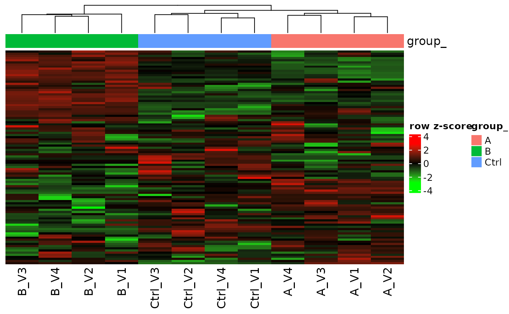

# Absent, not unknown: proteins missing in a whole group

## The problem

In label-free data a protein is often not observed in any sample of one
group. Most of the time it is there, but below the limit of detection
(LOD): the absence is information, not an unknown value. A linear model
per protein cannot estimate a group without observations, so `lm` drops
exactly these contrasts, often the ones with the largest changes.

``` r
library(prolfqua)
library(ggplot2)
sim <- sim_lfq_data_protein_config(Nprot = 100, weight_missing = 0.5, seed = 1234)
lfq <- LFQData$new(sim$data, sim$config)
contrasts <- c(AvsC = "group_A - group_Ctrl", BvsC = "group_B - group_Ctrl")

fa_lm <- build_contrast_analysis(lfq, "~ group_", contrasts, method = "lm")
lost <- fa_lm$get_missing()
lost
```

    ## # A tibble: 6 × 2
    ##   protein_Id  contrast
    ##   <chr>       <chr>   
    ## 1 cnCfON~9769 BvsC    
    ## 2 DoWup2~8058 BvsC    
    ## 3 LMQBev~8107 AvsC    
    ## 4 LMQBev~8107 BvsC    
    ## 5 umjHSH~2090 AvsC    
    ## 6 ZHBkZv~0394 AvsC

The intensities of these proteins show the empty groups:

``` r
lfq$data_long() |>
  dplyr::filter(protein_Id %in% lost$protein_Id) |>
  dplyr::select(protein_Id, sampleName, abundance) |>
  tidyr::pivot_wider(names_from = sampleName, values_from = abundance) |>
  knitr::kable(digits = 1)
```

| protein_Id  | A_V1 | A_V2 | A_V3 | A_V4 | B_V1 | B_V2 | B_V3 | B_V4 | Ctrl_V1 | Ctrl_V2 | Ctrl_V3 | Ctrl_V4 |
|:------------|-----:|-----:|-----:|-----:|-----:|-----:|-----:|-----:|--------:|--------:|--------:|--------:|
| cnCfON~9769 |   NA | 15.9 | 14.3 | 14.4 |   NA |   NA |   NA |   NA |      NA |    15.8 |    17.5 |      NA |
| DoWup2~8058 | 17.9 |   NA | 18.9 |   NA |   NA |   NA |   NA |   NA |      NA |      NA |      NA |      17 |
| LMQBev~8107 |   NA | 16.0 |   NA |   NA |   NA | 15.8 | 16.0 | 15.8 |      NA |      NA |      NA |      NA |
| umjHSH~2090 |   NA |   NA |   NA |   NA |   NA |   NA | 15.8 | 16.5 |      NA |      NA |    17.4 |      NA |
| ZHBkZv~0394 |   NA |   NA |   NA |   NA |   NA |   NA |   NA | 13.3 |      NA |      NA |    12.6 |      NA |

## The limit of detection

`MissingHelpers` estimates the LOD from the data. Groups in which a
protein is observed in only one sample, or in the fewest samples, are
the closest the data comes to the detection limit; the LOD is the median
(`prob = 0.5`) of their mean intensities.

``` r
mh <- MissingHelpers$new(lfq$data_long(), lfq$get_config())
mh$get_lod()
```

    ## [1] 15.97769

## lm_impute

`lm_impute` fits `lm` to every protein. Proteins whose fit fails, or
leaves a coefficient undefined, are refitted with their missing values
set to the LOD; observed values below the LOD are raised to it, because
they cannot be told apart from it. A constant imputed value has no
variance, so the residual variance of the refit would be too small;
`lm_impute` borrows it from the proteins that could be fitted. The
column `estimate_type` tells which route each estimate took. Pass `lod`
to
[`build_contrast_analysis()`](https://fgcz.github.io/prolfqua/reference/build_contrast_analysis.md)
to use a LOD of your own.

``` r
fa_imp <- build_contrast_analysis(lfq, "~ group_", contrasts, method = "lm_impute")
res <- fa_imp$get_contrasts()
dplyr::count(res, contrast, estimate_type)
```

    ## # A tibble: 4 × 3
    ##   contrast estimate_type     n
    ##   <chr>    <chr>         <int>
    ## 1 AvsC     lod_imputed       7
    ## 2 AvsC     observed         93
    ## 3 BvsC     lod_imputed       7
    ## 4 BvsC     observed         93

``` r
nrow(fa_imp$get_missing())
```

    ## [1] 0

The estimates for the proteins that `lm` lost. A protein observed only
near or below the LOD ends up with `diff` close to 0: there is no
evidence that it changes.

``` r
res |>
  dplyr::semi_join(lost, by = c("protein_Id", "contrast")) |>
  dplyr::select(protein_Id, contrast, diff, p.value, FDR) |>
  knitr::kable(digits = 3)
```

| protein_Id  | contrast |   diff | p.value |   FDR |
|:------------|:---------|-------:|--------:|------:|
| LMQBev~8107 | AvsC     |  0.003 |   0.997 | 1.000 |
| umjHSH~2090 | AvsC     | -0.873 |   0.367 | 0.874 |
| ZHBkZv~0394 | AvsC     |  0.000 |   1.000 | 1.000 |
| cnCfON~9769 | BvsC     | -0.508 |   0.605 | 0.785 |
| DoWup2~8058 | BvsC     | -0.401 |   0.697 | 0.829 |
| LMQBev~8107 | BvsC     |  0.002 |   0.998 | 1.000 |

``` r
ggplot(res, aes(diff, -log10(p.value), colour = estimate_type)) +
  geom_point() +
  facet_wrap(~contrast) +
  theme_minimal()
```


Volcano plot of lm_impute; colour marks the estimates refitted at the
LOD.

## Other methods

The same refit at the LOD is available with `limma_impute`,
`limma_voom_impute` and `rfit_impute`. `hurdle_nested` takes a different
route: it models the intensities and the peptide detection separately
and combines their p-values. The number of estimated protein and
contrast pairs per method:

``` r
methods <- c("lm", "lm_impute", "limma", "limma_impute", "rfit", "rfit_impute")
estimated <- vapply(methods, function(m) {
  nrow(build_contrast_analysis(lfq, "~ group_", contrasts, method = m)$get_contrasts())
}, integer(1))
knitr::kable(data.frame(method = methods, estimated = estimated), row.names = FALSE)
```

| method       | estimated |
|:-------------|----------:|
| lm           |       194 |
| lm_impute    |       200 |
| limma        |       192 |
| limma_impute |       200 |
| rfit         |       194 |
| rfit_impute  |       200 |

The article [Contrast facades with parallel
designs](https://fgcz.github.io/prolfqua/articles/ContrastFacades.html)
compares them on peptide-level data, including the hurdle model.

## Completing the data matrix

[`impute_from_model()`](https://fgcz.github.io/prolfqua/reference/impute_from_model.md)
fills every missing cell with the prediction of its protein model:
`fitted` for proteins fitted on their observed values, `lod_refit` for
proteins refitted at the LOD, `complete` for proteins without missing
values. The filled matrix is useful for heatmaps or clustering. The
filled values carry no noise, so do not use them for further tests.

``` r
filled <- impute_from_model(fa_imp$model, lfq)
table(filled$summary$route)
```

    ## 
    ##  complete    fitted lod_refit 
    ##        23        70         7

``` r
filled$lfqdata$get_Plotter()$heatmap()
```



## Session Info

``` r
sessionInfo()
```

    ## R version 4.5.2 (2025-10-31)
    ## Platform: x86_64-pc-linux-gnu
    ## Running under: Ubuntu 24.04.5 LTS
    ## 
    ## Matrix products: default
    ## BLAS:   /usr/lib/x86_64-linux-gnu/openblas-pthread/libblas.so.3 
    ## LAPACK: /usr/lib/x86_64-linux-gnu/openblas-pthread/libopenblasp-r0.3.26.so;  LAPACK version 3.12.0
    ## 
    ## locale:
    ##  [1] LC_CTYPE=C.UTF-8       LC_NUMERIC=C           LC_TIME=C.UTF-8       
    ##  [4] LC_COLLATE=C.UTF-8     LC_MONETARY=C.UTF-8    LC_MESSAGES=C.UTF-8   
    ##  [7] LC_PAPER=C.UTF-8       LC_NAME=C              LC_ADDRESS=C          
    ## [10] LC_TELEPHONE=C         LC_MEASUREMENT=C.UTF-8 LC_IDENTIFICATION=C   
    ## 
    ## time zone: UTC
    ## tzcode source: system (glibc)
    ## 
    ## attached base packages:
    ## [1] stats     graphics  grDevices utils     datasets  methods   base     
    ## 
    ## other attached packages:
    ## [1] ggplot2_4.0.3  prolfqua_1.9.0
    ## 
    ## loaded via a namespace (and not attached):
    ##   [1] Rdpack_2.6.6           gridExtra_2.3.1        rlang_1.3.0           
    ##   [4] magrittr_2.0.5         clue_0.3-68            GetoptLong_1.1.1      
    ##   [7] otel_0.2.0             matrixStats_1.5.0      compiler_4.5.2        
    ##  [10] mgcv_1.9-3             png_0.1-9              systemfonts_1.3.2     
    ##  [13] vctrs_0.7.3            pkgconfig_2.0.3        shape_1.4.6.1         
    ##  [16] crayon_1.5.3           fastmap_1.2.0          backports_1.5.1       
    ##  [19] labeling_0.4.3         utf8_1.2.6             rmarkdown_2.32        
    ##  [22] nloptr_2.2.1           ragg_1.5.2             UpSetR_1.4.1          
    ##  [25] purrr_1.2.2            xfun_0.62              glmnet_5.2            
    ##  [28] jomo_2.7-6             logistf_1.26.1         cachem_1.1.0          
    ##  [31] jsonlite_2.0.0         progress_1.2.3         pan_2.0               
    ##  [34] Rfit_0.27.0            broom_1.0.13           parallel_4.5.2        
    ##  [37] prettyunits_1.2.0      cluster_2.1.8.1        R6_2.6.1              
    ##  [40] bslib_0.12.0           stringi_1.8.9          RColorBrewer_1.1-3    
    ##  [43] limma_3.66.0           boot_1.3-32            rpart_4.1.24          
    ##  [46] jquerylib_0.1.4        Rcpp_1.1.2             iterators_1.0.14      
    ##  [49] knitr_1.52             IRanges_2.44.0         Matrix_1.7-4          
    ##  [52] splines_4.5.2          nnet_7.3-20            tidyselect_1.2.1      
    ##  [55] yaml_2.3.12            doParallel_1.0.17      codetools_0.2-20      
    ##  [58] lattice_0.22-7         tibble_3.3.1           plyr_1.8.9            
    ##  [61] withr_3.0.3            S7_0.2.2               evaluate_1.0.5        
    ##  [64] desc_1.4.3             survival_3.8-3         circlize_0.4.18       
    ##  [67] pillar_1.11.1          mice_3.19.0            foreach_1.5.2         
    ##  [70] stats4_4.5.2           reformulas_0.4.4       plotly_4.12.1         
    ##  [73] generics_0.1.4         S4Vectors_0.48.1       hms_1.1.4             
    ##  [76] scales_1.4.0           minqa_1.2.8            glue_1.8.1            
    ##  [79] tools_4.5.2            data.table_1.18.6.1    lme4_2.1-0            
    ##  [82] forcats_1.0.1          fs_2.1.0               grid_4.5.2            
    ##  [85] tidyr_1.3.2            rbibutils_2.4.1        colorspace_2.1-4      
    ##  [88] nlme_3.1-168           formula.tools_1.7.1    cli_3.6.6             
    ##  [91] textshaping_1.0.5      viridisLite_0.4.3      ComplexHeatmap_2.26.1 
    ##  [94] dplyr_1.2.1            gtable_0.3.6           sass_0.4.10           
    ##  [97] digest_0.6.39          operator.tools_1.6.3.1 BiocGenerics_0.56.0   
    ## [100] ggrepel_0.9.8          rjson_0.2.23           htmlwidgets_1.6.4     
    ## [103] farver_2.1.2           htmltools_0.5.9        pkgdown_2.2.1         
    ## [106] lifecycle_1.0.5        httr_1.4.9             GlobalOptions_0.1.4   
    ## [109] mitml_0.4-5            statmod_1.5.2          MASS_7.3-65
