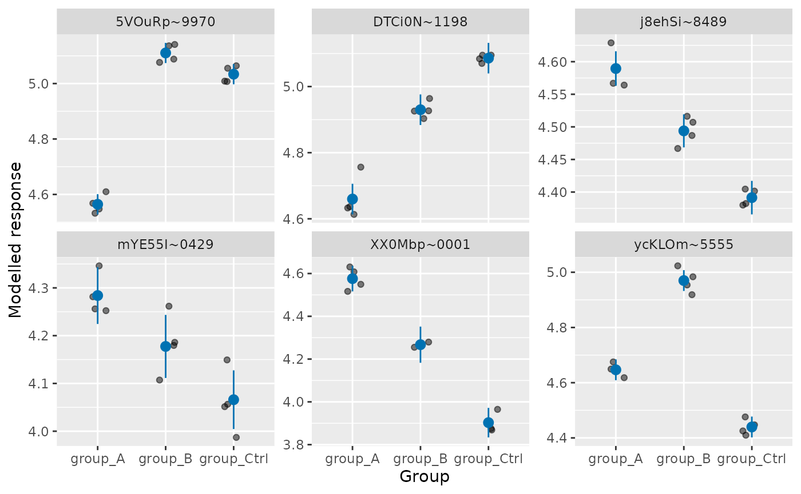
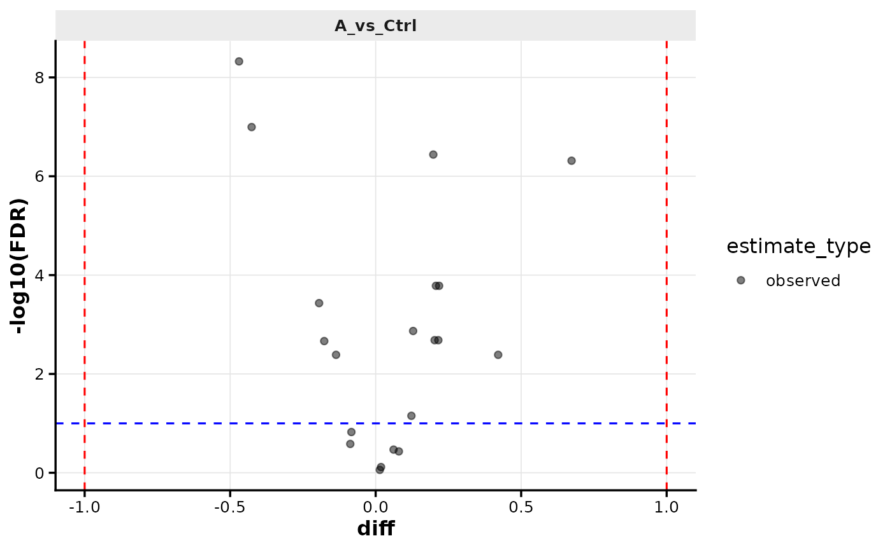

# All modelling methods at a glance

## Purpose

[`build_contrast_analysis()`](https://fgcz.github.io/prolfqua/reference/build_contrast_analysis.md)
selects the model with its `method` argument. This vignette runs every
method listed by
[`list_facades()`](https://fgcz.github.io/prolfqua/reference/list_facades.md)
on one small simulated dataset and shows one line of output per method.
Plots and a discussion of the methods are in the article [Comparing
modelling methods on one
dataset](https://fgcz.github.io/prolfqua/articles/ComparingMethods.html).


build_contrast_analysis() is a factory: the method key selects the
model, and every model rolls out with the same interface.

## Data

We simulate peptide intensities for 20 proteins in three groups and
compare group `A` with the control.

``` r
library(prolfqua)
sim <- sim_lfq_data_peptide_config(Nprot = 20, seed = 42)
lfq_peptide <- LFQData$new(sim$data, sim$config)
lfq_peptide <- lfq_peptide$get_Transformer()$log2()$lfq
lfq_protein <- lfq_peptide$get_Aggregator()$aggregate()
lfq_limpa <- AggregateLimpa$new(lfq_peptide, "protein")$aggregate()
contrasts <- c(A_vs_Ctrl = "group_A - group_Ctrl")
```

Each method declares the input it needs:

- `aggregated`: protein-level input, here `lfq_protein` aggregated with
  median polish. `limpa` takes `lfq_limpa`, aggregated by
  `AggregateLimpa`, which adds the per-protein standard errors it needs.
- `nested`: peptide-level input, `lfq_peptide`. The method models the
  peptides and reports protein-level contrasts.

## Fit all methods

``` r
facades <- list_facades()
input_for <- function(method) {
  if (method == "limpa") {
    return(lfq_limpa)
  }
  if (facades[[method]]$needs == "nested") lfq_peptide else lfq_protein
}
model_for <- function(method) {
  if (method == "lmer_nested") "~ group_ + (1 | peptide_Id) + (1 | sampleName)" else "~ group_"
}
results <- lapply(names(facades), function(method) {
  fa <- build_contrast_analysis(input_for(method), model_for(method), contrasts, method = method)
  fa$get_contrasts()
})
names(results) <- names(facades)
```

## One line per method

``` r
about <- c(
  lm = "linear model per protein",
  lm_impute = "lm; groups without observations imputed at the limit of detection (LOD)",
  rlm = "robust linear model (MASS::rlm)",
  rfit = "rank-based regression (Rfit)",
  rfit_impute = "rfit with LOD imputation",
  limma = "limma, empirical-Bayes moderated variances",
  limma_impute = "limma with LOD imputation",
  limma_voom = "limma with vooma precision weights",
  limma_voom_impute = "limma_voom with LOD imputation",
  deqms = "limma with DEqMS peptide-count variance moderation",
  deqms_voom = "deqms with vooma precision weights",
  limpa = "limma on limpa DPC-quantified proteins",
  limpa_nested = "limpa, DPC quantification from peptides",
  firth = "Firth logistic regression, protein detection",
  binomial_nested = "quasibinomial model, peptide detection counts",
  binomial_firth_nested = "binomial_nested with Firth bias reduction",
  hurdle_nested = "lm_impute intensity + binomial_firth_nested detection",
  lmer_nested = "mixed model, peptide and sample random effects",
  ropeca_nested = "peptide fold changes summarised per protein (ROPECA)",
  ropecaV2_nested = "ROPECA with an exact, correlation-aware null for the median peptide z-score"
)
overview <- data.frame(
  method = names(results),
  input = vapply(facades, function(x) x$needs, character(1)),
  proteins = vapply(results, nrow, integer(1)),
  FDR_lt_0.1 = vapply(results, function(x) sum(x$FDR < 0.1, na.rm = TRUE), integer(1)),
  model = about[names(results)]
)
knitr::kable(overview, row.names = FALSE)
```

| method | input | proteins | FDR_lt_0.1 | model |
|:---|:---|---:|---:|:---|
| binomial_firth_nested | nested | 20 | 0 | binomial_nested with Firth bias reduction |
| binomial_nested | nested | 20 | 0 | quasibinomial model, peptide detection counts |
| deqms | aggregated | 20 | 14 | limma with DEqMS peptide-count variance moderation |
| deqms_voom | aggregated | 20 | 13 | deqms with vooma precision weights |
| firth | aggregated | 20 | 0 | Firth logistic regression, protein detection |
| hurdle_nested | nested | 20 | 14 | lm_impute intensity + binomial_firth_nested detection |
| limma | aggregated | 20 | 14 | limma, empirical-Bayes moderated variances |
| limma_impute | aggregated | 20 | 14 | limma with LOD imputation |
| limma_voom | aggregated | 20 | 14 | limma with vooma precision weights |
| limma_voom_impute | aggregated | 20 | 14 | limma_voom with LOD imputation |
| limpa | aggregated | 20 | 16 | limma on limpa DPC-quantified proteins |
| limpa_nested | nested | 20 | 16 | limpa, DPC quantification from peptides |
| lm | aggregated | 20 | 14 | linear model per protein |
| lm_impute | aggregated | 20 | 14 | lm; groups without observations imputed at the limit of detection (LOD) |
| lmer_nested | nested | 12 | 5 | mixed model, peptide and sample random effects |
| rfit | aggregated | 20 | 14 | rank-based regression (Rfit) |
| rfit_impute | aggregated | 20 | 14 | rfit with LOD imputation |
| rlm | aggregated | 20 | 14 | robust linear model (MASS::rlm) |
| ropeca_nested | nested | 20 | 14 | peptide fold changes summarised per protein (ROPECA) |
| ropecaV2_nested | nested | 20 | 16 | ROPECA with an exact, correlation-aware null for the median peptide z-score |

The detection models (`firth`, `binomial_nested`,
`binomial_firth_nested`) test differences in how often a protein or its
peptides are observed. The simulated data has few missing values, so
they find little.

## Missing values

An `NA` intensity is a missing observation, and the method decides what
happens to it:

- dropped in each per-protein fit: `lm`, `rlm`, `rfit`, `limma`,
  `limma_voom`, `deqms`, `lmer_nested`, `ropeca_nested`
- imputed at the limit of detection where a whole group is missing: the
  `_impute` methods
- modelled as detection: `firth`, `binomial_nested`,
  `binomial_firth_nested`, and `hurdle_nested` together with the
  intensities
- filled from the fitted models after the analysis:
  [`impute_from_model()`](https://fgcz.github.io/prolfqua/reference/impute_from_model.md)

The [`log2()`](https://rdrr.io/r/base/Log.html) transform turns zero
intensities, which mean “not detected”, into `NA`. `Inf`, `-Inf` and
`NaN` intensities, and `NA` in protein, peptide, group or sample
columns, stop the analysis with a classed error.

What happened on the way is recorded: `$provenance()` of the analysis
lists the values set to `NA`, removed rows, failed or singular fits,
missing responses dropped per fit, and the proteins absent from a
contrast with the reason.

## One protein, all methods

All methods return the same columns. Here is the protein with the
smallest `lm` p-value. For the detection models `diff` is a log odds
ratio, not a log2 fold change. This protein is detected in every sample,
so the detection models report `diff` 0 and a p-value of 1 or `NaN`.

``` r
top <- results$lm$protein_Id[which.min(results$lm$p.value)]
one <- lapply(results, function(x) x[x$protein_Id == top, c("diff", "p.value", "FDR")])
one <- dplyr::bind_rows(one, .id = "method")
knitr::kable(one, digits = 3)
```

| method                |   diff | p.value |   FDR |
|:----------------------|-------:|--------:|------:|
| binomial_firth_nested |  0.000 |   1.000 | 1.000 |
| binomial_nested       |  0.000 |   1.000 | 1.000 |
| deqms                 | -0.469 |   0.000 | 0.000 |
| deqms_voom            | -0.469 |   0.000 | 0.000 |
| firth                 |  0.000 |   1.000 | 1.000 |
| hurdle_nested         | -0.469 |   0.000 | 0.000 |
| limma                 | -0.469 |   0.000 | 0.000 |
| limma_impute          | -0.469 |   0.000 | 0.000 |
| limma_voom            | -0.469 |   0.000 | 0.000 |
| limma_voom_impute     | -0.469 |   0.000 | 0.000 |
| limpa                 | -0.272 |   0.000 | 0.000 |
| limpa_nested          | -0.272 |   0.000 | 0.000 |
| lm                    | -0.469 |   0.000 | 0.000 |
| lm_impute             | -0.469 |   0.000 | 0.000 |
| lmer_nested           | -0.276 |   0.001 | 0.003 |
| rfit                  | -0.463 |   0.000 | 0.000 |
| rfit_impute           | -0.463 |   0.000 | 0.000 |
| rlm                   | -0.469 |   0.000 | 0.000 |
| ropeca_nested         | -0.495 |   0.000 | 0.000 |
| ropecaV2_nested       | -0.495 |   0.000 | 0.000 |

## Inspecting a fitted analysis

The fitted analysis supports standard R methods.
[`print()`](https://rdrr.io/r/base/print.html) gives the model
specification, fit counts, a one-line provenance summary and a
coefficient preview without calculating contrasts.
[`summary()`](https://rdrr.io/r/base/summary.html) evaluates the
contrasts and counts estimated, missing and significant results; the
significance defaults are FDR \< 0.05 and absolute effect \> 1.

``` r
analysis <- build_contrast_analysis(lfq_protein, "~ group_", contrasts, method = "lm")
print(analysis)
#> prolfqua analysis: lm ( ContrastsLMFacade )
#> Formula: medpolish ~ group_ 
#> Contrasts: A_vs_Ctrl 
#> Input subjects: 20 
#> # A tibble: 1 × 6
#>   subjects fitted failed singular imputed not_converged
#>      <int>  <int>  <int>    <int>   <int>         <int>
#> 1       20     20      0        0       0             0
#> Provenance: 0 failure and 1 other entries; see $provenance() 
#> Coefficient preview:
#> # A tibble: 6 × 5
#>   protein_Id  term        estimate std.error    df
#>   <chr>       <chr>          <dbl>     <dbl> <dbl>
#> 1 0CubNR~5740 (Intercept)   4.67      0.0547     9
#> 2 0CubNR~5740 group_B      -0.162     0.0756     9
#> 3 0CubNR~5740 group_Ctrl    0.0872    0.0741     9
#> 4 2kfAGV~3196 (Intercept)   4.65      0.0296     8
#> 5 2kfAGV~3196 group_B      -0.21      0.0419     8
#> 6 2kfAGV~3196 group_Ctrl   -0.215     0.0453     8
summary(analysis)
#> prolfqua analysis summary: lm 
#> Formula: medpolish ~ group_ 
#> # A tibble: 1 × 6
#>   subjects fitted failed singular imputed not_converged
#>      <int>  <int>  <int>    <int>   <int>         <int>
#> 1       20     20      0        0       0             0
#> # A tibble: 1 × 8
#>   contrast  estimated missing significant    up  down median_sigma median_df
#>   <chr>         <int>   <int>       <int> <int> <int>        <dbl>     <dbl>
#> 1 A_vs_Ctrl        20       0           0     0     0       0.0701      12.2
#> Provenance: 0 failure and 1 other entries; see $provenance()
analysis$provenance()
#> # A tibble: 1 × 8
#>   source step        event                       n ids   reason failure response
#>   <chr>  <chr>       <chr>                   <int> <lis> <chr>  <lgl>   <chr>   
#> 1 model  fit (Model) missing responses drop…    22 <chr> NA re… FALSE   NA
head(coef(analysis))
#> # A tibble: 6 × 5
#>   protein_Id  term        estimate std.error    df
#>   <chr>       <chr>          <dbl>     <dbl> <dbl>
#> 1 0CubNR~5740 (Intercept)   4.67      0.0547     9
#> 2 0CubNR~5740 group_B      -0.162     0.0756     9
#> 3 0CubNR~5740 group_Ctrl    0.0872    0.0741     9
#> 4 2kfAGV~3196 (Intercept)   4.65      0.0296     8
#> 5 2kfAGV~3196 group_B      -0.210     0.0419     8
#> 6 2kfAGV~3196 group_Ctrl   -0.215     0.0453     8
head(vcov(analysis))
#> # A tibble: 6 × 4
#>   protein_Id  term        term2       covariance
#>   <chr>       <chr>       <chr>            <dbl>
#> 1 0CubNR~5740 (Intercept) (Intercept)    0.00299
#> 2 0CubNR~5740 group_B     (Intercept)   -0.00299
#> 3 0CubNR~5740 group_Ctrl  (Intercept)   -0.00299
#> 4 0CubNR~5740 (Intercept) group_B       -0.00299
#> 5 0CubNR~5740 group_B     group_B        0.00572
#> 6 0CubNR~5740 group_Ctrl  group_B        0.00299
head(confint(analysis))
#> # A tibble: 6 × 7
#>   protein_Id  term        estimate std.error    df conf.low conf.high
#>   <chr>       <chr>          <dbl>     <dbl> <dbl>    <dbl>     <dbl>
#> 1 0CubNR~5740 (Intercept)   4.67      0.0547     9   4.55     4.80   
#> 2 0CubNR~5740 group_B      -0.162     0.0756     9  -0.333    0.00895
#> 3 0CubNR~5740 group_Ctrl    0.0872    0.0741     9  -0.0804   0.255  
#> 4 2kfAGV~3196 (Intercept)   4.65      0.0296     8   4.59     4.72   
#> 5 2kfAGV~3196 group_B      -0.210     0.0419     8  -0.307   -0.113  
#> 6 2kfAGV~3196 group_Ctrl   -0.215     0.0453     8  -0.320   -0.111
formula(analysis)
#> medpolish ~ group_
#> <environment: 0x5a1dc2f36f98>
head(nobs(analysis))
#> # A tibble: 6 × 2
#>   protein_Id   nobs
#>   <chr>       <dbl>
#> 1 0CubNR~5740    12
#> 2 2kfAGV~3196    11
#> 3 2yQxtd~5011    12
#> 4 5VOuRp~9970    12
#> 5 DOwxjj~3330    12
#> 6 DTCi0N~1198    12
head(fitted(analysis))
#> # A tibble: 6 × 6
#>   protein_Id  sampleName group_ response fitted imputed
#>   <chr>       <chr>      <chr>     <dbl>  <dbl> <lgl>  
#> 1 0CubNR~5740 A_V1       A          4.84   4.67 FALSE  
#> 2 0CubNR~5740 A_V2       A          4.65   4.67 FALSE  
#> 3 0CubNR~5740 A_V3       A          4.49   4.67 FALSE  
#> 4 0CubNR~5740 A_V4       A          4.81   4.67 FALSE  
#> 5 0CubNR~5740 B_V1       B          4.58   4.51 FALSE  
#> 6 0CubNR~5740 B_V2       B          4.60   4.51 FALSE
head(residuals(analysis))
#> # A tibble: 6 × 6
#>   protein_Id  sampleName group_ response residual imputed
#>   <chr>       <chr>      <chr>     <dbl>    <dbl> <lgl>  
#> 1 0CubNR~5740 A_V1       A          4.84   0.166  FALSE  
#> 2 0CubNR~5740 A_V2       A          4.65  -0.0194 FALSE  
#> 3 0CubNR~5740 A_V3       A          4.49  -0.182  FALSE  
#> 4 0CubNR~5740 A_V4       A          4.81   0.136  FALSE  
#> 5 0CubNR~5740 B_V1       B          4.58   0.0730 FALSE  
#> 6 0CubNR~5740 B_V2       B          4.60   0.0915 FALSE
plot(analysis)
```



``` r
plot(analysis, type = "volcano")
```



Coefficient tables describe the fitted model; requested comparisons
remain available through `analysis$get_contrasts()`. Confidence
intervals are Wald t intervals, with moderated standard errors and
degrees of freedom for limma and normal Wald intervals for the Firth
logistic backend. ROPECA coefficient tables are keyed by protein and
peptide because those methods fit peptide-level models.

[`vcov()`](https://rdrr.io/r/stats/vcov.html) returns the coefficient
covariance as a long table keyed by subject, `term` and `term2`.
LOD-refitted models use their borrowed covariance; matrix models use the
moderated variance and each subject’s weighted design. The default plot
shows observed responses and fitted group means with confidence
intervals for the six subjects with the smallest FDR in the first
contrast. Select other subjects with
`plot(analysis, subject = top, level = 0.9)`. Points and intervals share
the modelled response scale; detection models show probabilities, and
mixed models use fixed-effect means with Satterthwaite intervals. For
multiple factors, the plotted means correspond to factor combinations.
ROPECA plots have one panel per peptide of each selected protein.
Volcano and MA plots remain available through `type = "volcano"` and
`type = "ma"`; combined hurdle analyses default to volcano and require
selecting an intensity or detection component for a fitted plot.

The modelling call retains its input, and the fitted-value and residual
accessors retain observed modelled responses. Internal child-feature
aggregation and detection encoding have no inverse. Preceding LFQData
transformations retain their original input columns; they are not
recorded as a new transformation-history object. See
[`?build_contrast_analysis`](https://fgcz.github.io/prolfqua/reference/build_contrast_analysis.md)
for the affected methods and output scales.

Fitted values and residuals retain sample, factor and available
child-feature identifiers. They include observed responses from
successful fits and a subject-level `imputed` flag; rows filled during
LOD imputation are excluded. The values use the fitting scale: log2
intensity here, and probabilities for detection models. Binomial
detection responses are the adjusted proportions used in fitting;
response residuals equal response minus fitted probability.
[`nobs()`](https://rdrr.io/r/stats/nobs.html) excludes imputed
observations.

Hurdle results combine two fitted models. Their print, summary and plot
methods describe the combined analysis; use
`analysis$contrast$intensity` or `analysis$contrast$detection` for
coefficients, formula, observation counts, fitted values and residuals.

## Session info

``` r
sessionInfo()
#> R version 4.6.2 (2026-10-29)
#> Platform: x86_64-pc-linux-gnu
#> Running under: Ubuntu 26.04.1 LTS
#> 
#> Matrix products: default
#> BLAS:   /usr/lib/x86_64-linux-gnu/openblas-pthread/libblas.so.3 
#> LAPACK: /usr/lib/x86_64-linux-gnu/openblas-pthread/libopenblasp-r0.3.32.so;  LAPACK version 3.12.0
#> 
#> locale:
#>  [1] LC_CTYPE=C.UTF-8       LC_NUMERIC=C           LC_TIME=C.UTF-8       
#>  [4] LC_COLLATE=C.UTF-8     LC_MONETARY=C.UTF-8    LC_MESSAGES=C.UTF-8   
#>  [7] LC_PAPER=C.UTF-8       LC_NAME=C              LC_ADDRESS=C          
#> [10] LC_TELEPHONE=C         LC_MEASUREMENT=C.UTF-8 LC_IDENTIFICATION=C   
#> 
#> time zone: UTC
#> tzcode source: system (glibc)
#> 
#> attached base packages:
#> [1] stats     graphics  grDevices utils     datasets  methods   base     
#> 
#> other attached packages:
#> [1] prolfqua_1.9.4   BiocStyle_2.40.0
#> 
#> loaded via a namespace (and not attached):
#>  [1] tidyselect_1.2.1       dplyr_1.2.1            farver_2.1.2          
#>  [4] S7_1.0.0               fastmap_1.2.0          rpart_4.1.27          
#>  [7] digest_0.6.39          lifecycle_1.0.5        Rfit_0.27.0           
#> [10] survival_3.8-12        statmod_1.5.2          magrittr_2.0.5        
#> [13] compiler_4.6.2         rlang_1.3.0            sass_0.4.10           
#> [16] progress_1.2.3         tools_4.6.2            utf8_1.2.6            
#> [19] yaml_2.3.12            data.table_1.18.6.1    limpa_1.4.2           
#> [22] knitr_1.52             labeling_0.4.3         prettyunits_1.2.0     
#> [25] htmlwidgets_1.6.4      RColorBrewer_1.1-3     numDeriv_2016.8-1.1   
#> [28] withr_3.0.3            purrr_1.2.2            desc_1.4.3            
#> [31] nnet_7.3-21            grid_4.6.2             jomo_2.7-6            
#> [34] mice_3.19.0            ggplot2_4.0.4          scales_1.4.0          
#> [37] iterators_1.0.14       MASS_7.3-66            cli_3.6.6             
#> [40] rmarkdown_2.32         crayon_1.5.3           ragg_1.5.2            
#> [43] reformulas_0.4.4       generics_0.1.4         otel_0.3.0            
#> [46] minqa_1.2.8            cachem_1.1.0           stringr_1.6.0         
#> [49] operator.tools_1.6.3.1 splines_4.6.2          BiocManager_1.30.27   
#> [52] vctrs_0.7.3            boot_1.3-32            glmnet_5.2            
#> [55] Matrix_1.7-6           jsonlite_2.0.0         bookdown_0.48         
#> [58] hms_1.1.4              mitml_0.4-5            ggrepel_0.9.8         
#> [61] systemfonts_1.3.3      foreach_1.5.2          limma_3.68.5          
#> [64] tidyr_1.3.2            jquerylib_0.1.4        glue_1.8.1            
#> [67] pkgdown_2.2.1          nloptr_2.2.1           pan_2.0               
#> [70] codetools_0.2-20       stringi_1.8.9          gtable_0.3.6          
#> [73] shape_1.4.6.1          lmerTest_3.2-1         lme4_2.1-0            
#> [76] tibble_3.3.1           pillar_1.11.1          htmltools_0.5.9       
#> [79] R6_2.6.1               textshaping_1.0.5      Rdpack_2.6.6          
#> [82] formula.tools_1.7.1    evaluate_1.0.5         lattice_0.23-1        
#> [85] rbibutils_2.4.1        backports_1.5.1        broom_1.0.13          
#> [88] bslib_0.12.0           Rcpp_1.1.2             nlme_3.1-171          
#> [91] mgcv_1.9-4             logistf_1.26.1         xfun_0.62             
#> [94] fs_2.1.0               pkgconfig_2.0.3
```
