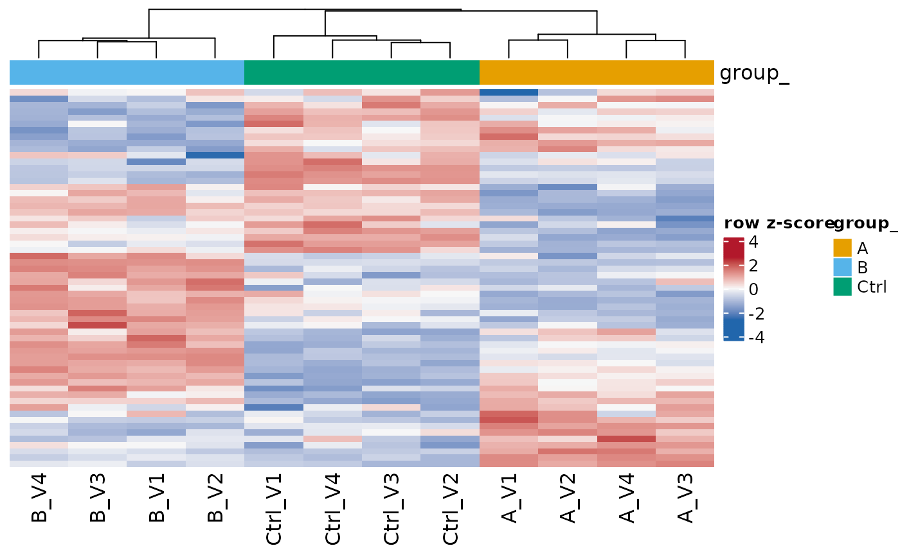
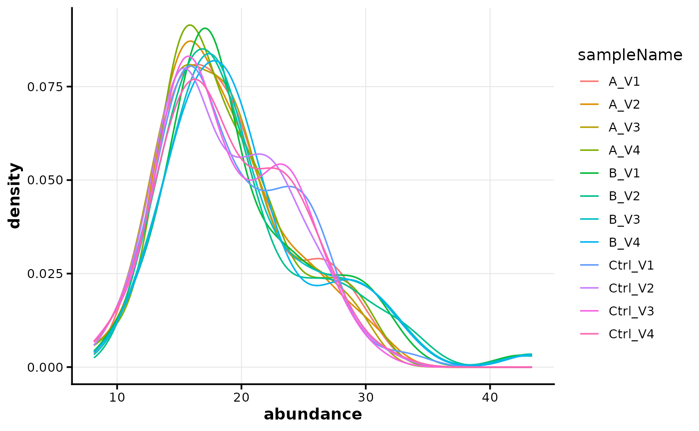
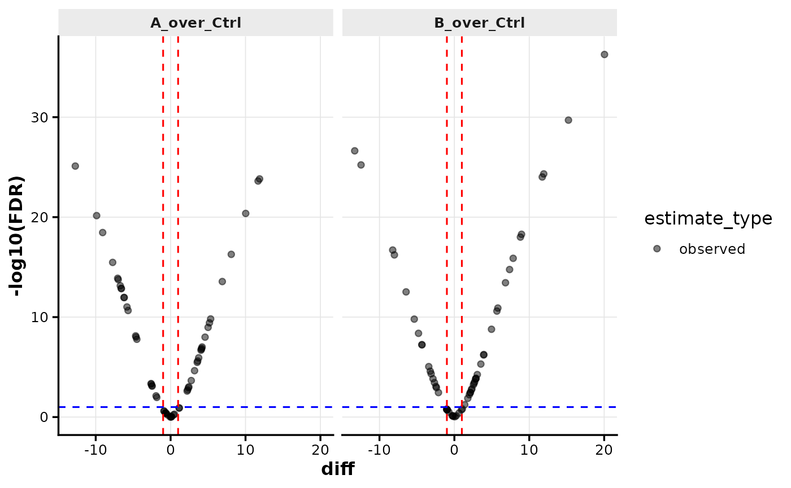
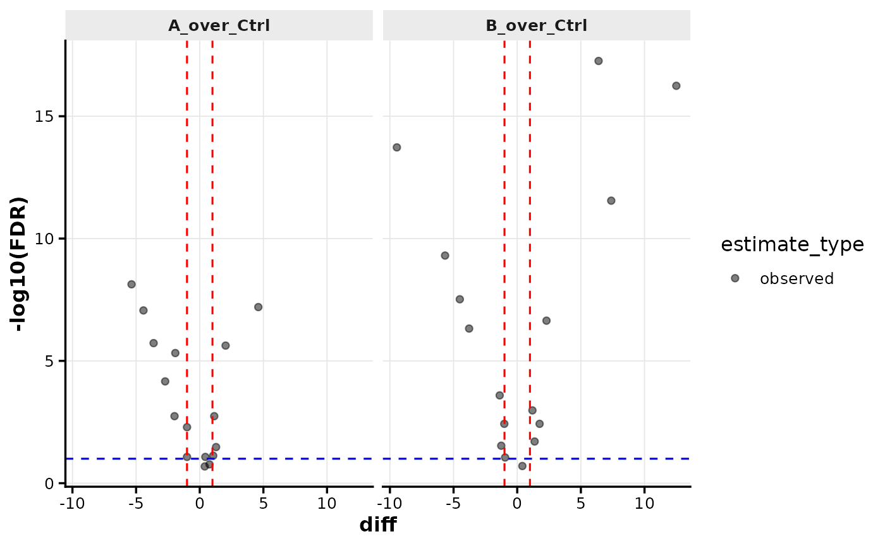

# Simulating peptide-level data

### Simulate data

For proteins: - the proteins have a FC either equal 1, 0. or -1, 10%
have 1 80% have 0 and 10% have -1.

What we however are measuring are peptide spectrum matches. Let’s assume
we observing peptides.

For peptides:

- The transformed protein abundances have a log normal distribution with
  `meanlog = log(20)`, and `sd = log(1.2)`.
- The number of peptides per protein follow a geometric distribution,
  $`N_{pep} \sim Geo(p)`$ with $`p = 0.3`$
- The peptide abundances of a protein have log normal distribution with
  `meanlog = log(proteinabundance)` and `sd = log(1.2)`
- The log2 intensities of a peptide within a group follow a normal
  distribution distribution \$I\_{pep} LogNormal(,) \$, where $`\mu`$ is
  the peptide abundance and $`\sigma`$

``` r
peptideAbundances <- prolfqua::sim_lfq_data(peptide = TRUE)
```

## Analyse simulated data with prolfqua

``` r
library(prolfqua)

config <- AnalysisConfiguration$new()
config$file_name = "sample"
config$factors["group_"] = "group"
config$hierarchy[["protein_Id"]] = "proteinID"
config$hierarchy[["peptide_Id"]] = "peptideID"
config$set_response("abundance")

adata <- setup_analysis(peptideAbundances, config)

lfqdata <- prolfqua::LFQData$new(adata, config)
lfqdata$is_transformed(TRUE)

lfqdata$remove_small_intensities(threshold = 1)
lfqdata$filter_proteins_by_peptide_count()

lfqdata$factors()
```

    ## # A tibble: 12 × 3
    ##    sample  sampleName group_
    ##    <chr>   <chr>      <chr> 
    ##  1 A_V1    A_V1       A     
    ##  2 A_V2    A_V2       A     
    ##  3 A_V3    A_V3       A     
    ##  4 A_V4    A_V4       A     
    ##  5 B_V1    B_V1       B     
    ##  6 B_V2    B_V2       B     
    ##  7 B_V3    B_V3       B     
    ##  8 B_V4    B_V4       B     
    ##  9 Ctrl_V1 Ctrl_V1    Ctrl  
    ## 10 Ctrl_V2 Ctrl_V2    Ctrl  
    ## 11 Ctrl_V3 Ctrl_V3    Ctrl  
    ## 12 Ctrl_V4 Ctrl_V4    Ctrl

``` r
pl <- lfqdata$get_Plotter()
lfqdata$hierarchy_counts()
```

    ## # A tibble: 1 × 3
    ##   isotopeLabel protein_Id peptide_Id
    ##   <chr>             <int>      <int>
    ## 1 light                16         60

``` r
lfqdata$relevant_hierarchy_keys()
```

    ## [1] "protein_Id"

``` r
pl$heatmap()
```



``` r
pl$intensity_distribution_density()
```



## Fit peptide model

With `hierarchy_depth` 2, every peptide is modelled on its own.

``` r
lfqdata$set_config_value("hierarchy_depth", 2)
contr_spec <- c(
  "B_over_Ctrl" = "group_B - group_Ctrl",
  "A_over_Ctrl" = "group_A - group_Ctrl"
)
fa_pep <- build_contrast_analysis(lfqdata, "~ group_", contr_spec, method = "lm")
res_pep <- fa_pep$get_contrasts()
fa_pep$get_Plotter()$volcano()$FDR
```



Proteins with at least one peptide with FDR \< 0.05:

``` r
xx <- dplyr::filter(res_pep, FDR < 0.05)
signif <- lfqdata$get_copy()
signif$set_data(signif$data_long() |> dplyr::filter(protein_Id %in% xx$protein_Id))
signif$get_Plotter()$heatmap()
```


## Aggregate data

``` r
lfqdata$set_config_value("hierarchy_depth", 1)
protData <- lfqdata$get_Aggregator()$aggregate()
```

``` r
fa_prot <- build_contrast_analysis(protData, "~ group_", contr_spec, method = "lm_impute")
fa_prot$get_Plotter()$volcano()$FDR
```



``` r
ctr <- fa_prot$get_contrasts()
```

## Session Info

``` r
sessionInfo()
```

    ## R version 4.6.2 (2026-10-29)
    ## Platform: x86_64-pc-linux-gnu
    ## Running under: Ubuntu 26.04.1 LTS
    ## 
    ## Matrix products: default
    ## BLAS:   /usr/lib/x86_64-linux-gnu/openblas-pthread/libblas.so.3 
    ## LAPACK: /usr/lib/x86_64-linux-gnu/openblas-pthread/libopenblasp-r0.3.32.so;  LAPACK version 3.12.0
    ## 
    ## locale:
    ##  [1] LC_CTYPE=C.UTF-8       LC_NUMERIC=C           LC_TIME=C.UTF-8       
    ##  [4] LC_COLLATE=C.UTF-8     LC_MONETARY=C.UTF-8    LC_MESSAGES=C.UTF-8   
    ##  [7] LC_PAPER=C.UTF-8       LC_NAME=C              LC_ADDRESS=C          
    ## [10] LC_TELEPHONE=C         LC_MEASUREMENT=C.UTF-8 LC_IDENTIFICATION=C   
    ## 
    ## time zone: UTC
    ## tzcode source: system (glibc)
    ## 
    ## attached base packages:
    ## [1] stats     graphics  grDevices utils     datasets  methods   base     
    ## 
    ## other attached packages:
    ## [1] prolfqua_1.9.5
    ## 
    ## loaded via a namespace (and not attached):
    ##  [1] tidyselect_1.2.1      viridisLite_0.4.3     dplyr_1.2.1          
    ##  [4] farver_2.1.2          S7_1.0.0              fastmap_1.2.0        
    ##  [7] promises_1.5.0        digest_0.6.39         mime_0.13            
    ## [10] lifecycle_1.0.5       cluster_2.1.8.3       statmod_1.5.2        
    ## [13] magrittr_2.0.5        compiler_4.6.2        rlang_1.3.0          
    ## [16] sass_0.5.0            progress_1.2.3        tools_4.6.2          
    ## [19] utf8_1.2.6            yaml_2.3.12           data.table_1.18.6.1  
    ## [22] knitr_1.52            prettyunits_1.2.0     labeling_0.4.3       
    ## [25] htmlwidgets_1.6.4     RColorBrewer_1.1-3    withr_3.0.3          
    ## [28] purrr_1.2.2           BiocGenerics_0.58.1   desc_1.4.3           
    ## [31] grid_4.6.2            stats4_4.6.2          xtable_1.8-8         
    ## [34] colorspace_2.1-4      ggplot2_4.0.4         scales_1.4.0         
    ## [37] iterators_1.0.14      MASS_7.3-66           cli_3.6.6            
    ## [40] rmarkdown_2.32        crayon_1.5.3          ragg_1.5.2           
    ## [43] generics_0.1.4        otel_0.3.0            httr_1.4.9           
    ## [46] rjson_0.2.23          cachem_1.1.0          stringr_1.6.0        
    ## [49] parallel_4.6.2        matrixStats_1.5.0     vctrs_0.7.3          
    ## [52] jsonlite_2.0.0        hms_1.1.4             IRanges_2.46.0       
    ## [55] GetoptLong_1.1.1      S4Vectors_0.50.3      ggrepel_0.9.8        
    ## [58] clue_0.3-68           systemfonts_1.3.4     crosstalk_1.2.2      
    ## [61] foreach_1.5.2         limma_3.68.5          plotly_4.12.1        
    ## [64] tidyr_1.3.2           jquerylib_0.1.4       glue_1.8.1           
    ## [67] pkgdown_2.2.1         codetools_0.2-20      stringi_1.8.9        
    ## [70] gtable_0.3.6          shape_1.4.6.1         later_1.4.8          
    ## [73] ComplexHeatmap_2.28.0 tibble_3.3.1          pillar_1.11.1        
    ## [76] htmltools_0.5.9       circlize_0.4.18       R6_2.6.1             
    ## [79] textshaping_1.1.0     doParallel_1.0.17     evaluate_1.0.5       
    ## [82] shiny_1.15.0          png_0.1-9             httpuv_1.6.17        
    ## [85] bslib_0.12.0          Rcpp_1.1.2            xfun_0.62            
    ## [88] fs_2.1.0              pkgconfig_2.0.3       GlobalOptions_0.1.4
