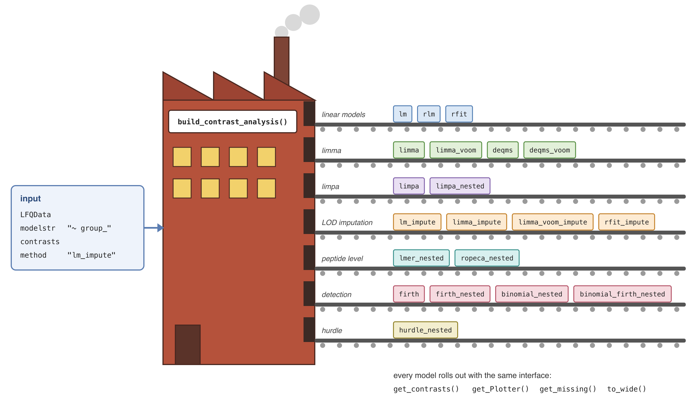

```{r setup, include = FALSE}
knitr::opts_chunk$set(collapse = TRUE, comment = "#>", message = FALSE, warning = FALSE)
```

```{r HexSticker, echo=FALSE, out.width="50%", eval=TRUE}
   
```

# Documentation

The vignettes of this package, in reading order:

1. Introduction to prolfqua (this vignette)
2. [Importing your data](CreatingConfigurations.html): reading your own data into an `AnalysisConfiguration`
3. [Comparing two groups](Comparing2Groups.html): QC, normalization and contrasts with `lm_impute`
4. [All modelling methods at a glance](ModellingMethods.html): every `build_contrast_analysis()` method on one small dataset
5. [Two-factor designs](TwoFactorDesigns.html)
6. [Contrasts from factors](ContrastsFromFactors.html)
7. [Filling the gaps: model-based imputation for heatmaps and PCA](ModelBasedImputation.html): completing the data matrix with `impute_from_model()`
8. [QC and sample size estimation](QualityControlAndSampleSizeEstimation.html)

The package website <https://fgcz.github.io/prolfqua/> has three more articles:

- [Comparing modelling methods on one dataset](https://fgcz.github.io/prolfqua/articles/ComparingMethods.html): all `build_contrast_analysis()` methods side by side, with plots
- [Simulating peptide-level data](https://fgcz.github.io/prolfqua/articles/SimulateData.html)
- [Under the hood: strategy, model and contrasts](https://fgcz.github.io/prolfqua/articles/LowLevelAPI.html): the classes behind `build_contrast_analysis()`

# Introduction

prolfqua covers the steps of a label-free quantification (LFQ) proteomics analysis: quality control, normalization, aggregation of peptides to proteins, modelling, hypothesis testing and sample size estimation [@Wolski2023prolfqua].

The centre of the package is a factory, `build_contrast_analysis()`. It takes the data, a model formula, the contrasts and a `method`, and returns a ready analysis: one model per protein and the requested contrasts.

```{r factory, echo = FALSE, out.width = "100%", fig.cap = "build_contrast_analysis() is a factory: the method key selects the model, and every model rolls out with the same interface."}

```

The `method` argument selects the model: linear models (`lm`, `rlm`, `rfit`), limma and limma-voom, DEqMS variance moderation, limpa's detection probability model, Firth logistic and binomial models of detection, mixed models and ROPECA on peptide-level data, a hurdle model combining intensity and detection, and variants that impute groups without observations at the limit of detection.

Every method returns an object with the same interface: `get_contrasts()`, `get_Plotter()`, `get_missing()` and `to_wide()`. Results of different methods therefore have the same columns and can be compared or combined directly.

`build_contrast_analysis()` takes its data as an `LFQData` object. The package works with data in long format, one row per measured feature (protein, peptide, precursor) and sample:

- `AnalysisConfiguration` maps the columns of the table to their roles: the feature hierarchy (protein, peptide, ...), the explanatory factors, the sample and the intensity column.
- `LFQData` holds the data together with its configuration. Its methods return helpers for transformation (`get_Transformer()`), aggregation (`get_Aggregator()`), summary statistics (`get_Stats()`), missing-value summaries (`get_Summariser()`) and plots (`get_Plotter()`).

# Installation

Install prolfqua from Bioconductor with:

```{r install, eval = FALSE}
if (!requireNamespace("BiocManager", quietly = TRUE)) {
  install.packages("BiocManager")
}
BiocManager::install("prolfqua")
```

The development version is available on GitHub:

```{r install-dev, eval = FALSE}
BiocManager::install("fgcz/prolfqua")
```

# Quick start

We simulate peptide-level intensities for 100 proteins measured in three groups (`A`, `B` and `Ctrl`). `sim_lfq_data_peptide_config()` returns the data together with a matching `AnalysisConfiguration`.

```{r simulate}
library(prolfqua)
istar <- sim_lfq_data_peptide_config(Nprot = 100, seed = 1234)
lfqdata <- LFQData$new(istar$data, istar$config)
lfqdata$factors() |> head()
```

We $\log_2$ transform the intensities, scale them robustly, and aggregate the peptides to proteins with Tukey's median polish.

```{r transform}
lfqdata <- lfqdata$get_Transformer()$log2()$robscale()$lfq
lfqprot <- lfqdata$get_Aggregator()$aggregate()
```

```{r density, fig.cap = "Distribution of the normalized protein intensities per sample."}
lfqprot$get_Plotter()$intensity_distribution_density()
```

We compare groups `A` and `B` with the control group using `lm_impute`: a linear model per protein with moderated variances. Proteins whose fit fails because a group has no observations are refitted with the missing values imputed at the limit of detection, borrowing the variance from the other proteins.

```{r contrasts}
contrasts <- c(
  "A_vs_Ctrl" = "group_A - group_Ctrl",
  "B_vs_Ctrl" = "group_B - group_Ctrl"
)
fa <- build_contrast_analysis(lfqprot, "~ group_", contrasts, method = "lm_impute")
res <- fa$get_contrasts()
head(res[, c("protein_Id", "contrast", "diff", "p.value", "FDR")])
```

```{r volcano, fig.cap = "Volcano plot of the two contrasts."}
fa$get_Plotter()$volcano()$FDR
```

All available methods are listed by `list_facades()`; the vignette [All modelling methods at a glance](ModellingMethods.html) runs each of them on one small dataset.

```{r facades}
names(list_facades())
```

# Session info

```{r session-info}
sessionInfo()
```

# References
